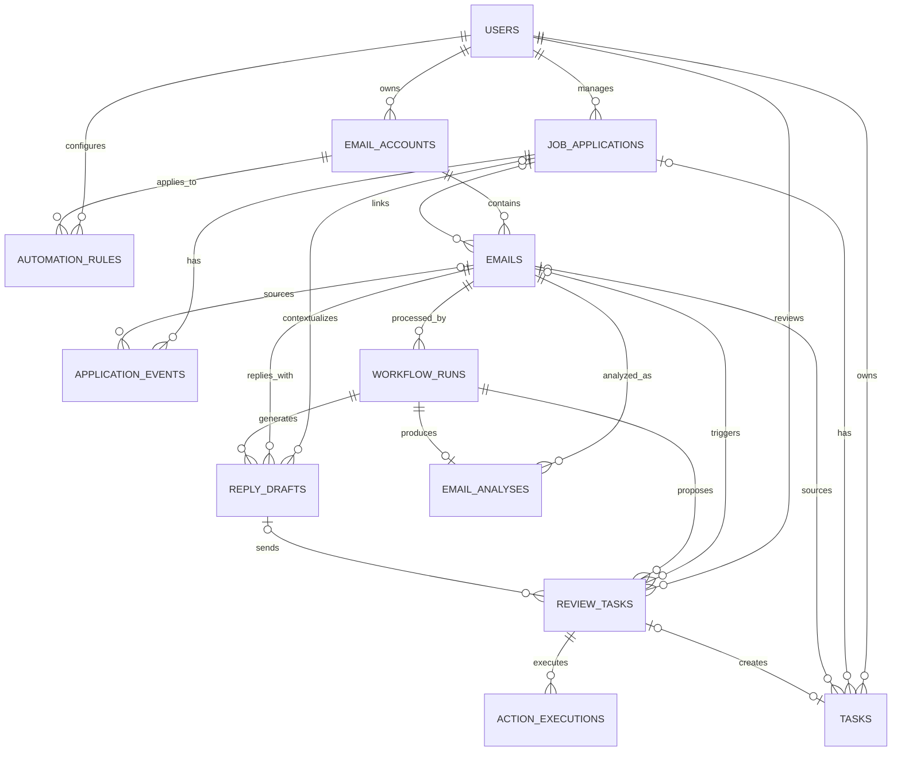

# 求职邮件智能管理系统数据库 ER 设计

> 状态：MVP 精简逻辑模型已确定，首批四张表的 Alembic DDL 已实现
> 版本：v1.2
> 日期：2026-07-27
> 数据库：MySQL 8.x / InnoDB / `utf8mb4`
> 规模：12 张核心表

## 1. 精简原则

数据库只为当前可演示功能服务，不为了“规范化完整”提前拆表。必须保留的边界是：

```text
邮件事实
≠ 模型分析
≠ 用户确认后的申请状态
≠ 待审核动作
≠ 最终执行结果
```

本版相对原19表方案的合并：

- 邮件正文、参与者和附件元数据并入 `emails`。
- 公司和岗位直接保存到 `job_applications`。
- 邮件通过 `application_id` 直接关联一个申请。
- 四个 Agent 的运行轨迹作为 JSON 保存到 `workflow_runs`。
- 建议动作和人工审核合并为 `review_tasks`。
- 同步批次结果暂由账户同步字段和应用日志记录。

这些合并不影响邮件分类、信息抽取、申请看板、日程、草稿、审核、发送和归档功能。

## 2. 核心 ER 图



## 3. 十二张核心表

| 编号 | 表 | 职责 |
|---:|---|---|
| 1 | `users` | 演示用户资料、时区和回复偏好 |
| 2 | `email_accounts` | IMAP/SMTP 配置、凭据引用和同步游标 |
| 3 | `emails` | 邮件事实、正文、附件元数据、文件夹与申请关联 |
| 4 | `email_analyses` | 分类和信息抽取的版本化结果 |
| 5 | `job_applications` | 公司、岗位和用户确认后的当前阶段 |
| 6 | `application_events` | 申请时间线与阶段变更历史 |
| 7 | `tasks` | 面试、笔试、材料和截止日期 |
| 8 | `reply_drafts` | 模型草稿和人工修改版本 |
| 9 | `workflow_runs` | LangGraph 运行状态、`thread_id` 和四 Agent 轨迹 |
| 10 | `review_tasks` | 建议动作、人工决定或规则批准 |
| 11 | `action_executions` | 数据库、SMTP、IMAP 归档等最终执行结果 |
| 12 | `automation_rules` | 低优先级邮件归档规则 |

LangGraph 的 SQLite checkpoint 由框架维护，不计入业务表。

## 4. 通用约定

- 普通主键使用 `BIGINT UNSIGNED AUTO_INCREMENT`。
- `workflow_runs.id` 和 `review_tasks.id` 使用 `CHAR(36)` UUID。
- 时间使用 `DATETIME(6)`，数据库统一保存 UTC。
- 分类、阶段和状态在 Python 中使用 Enum，数据库使用 `VARCHAR` + `CHECK`。
- 灵活的模型结果、证据、附件元数据和 Agent 轨迹使用 JSON。
- 需要并发保护的表使用 `version INT UNSIGNED NOT NULL DEFAULT 1`。
- MySQL 是业务数据唯一真相源；checkpoint 不能代替业务表。

## 5. 表结构

### 5.1 `users`

MVP 不实现完整账号系统，只保留一个配置好的演示用户。

| 字段 | 类型 | 说明 |
|---|---|---|
| `id` | BIGINT UNSIGNED | PK |
| `display_name` | VARCHAR(100) | 回复署名 |
| `email` | VARCHAR(320) | 可空，用户联系邮箱 |
| `timezone` | VARCHAR(64) | 默认 `Asia/Shanghai` |
| `reply_preferences` | JSON | 语言、语气、长度偏好 |
| `created_at` | DATETIME(6) | UTC |
| `updated_at` | DATETIME(6) | UTC |

首版由配置指定 `DEMO_USER_ID`，不建立注册、密码、Token 和角色权限。

### 5.2 `email_accounts`

| 字段 | 类型 | 说明 |
|---|---|---|
| `id` | BIGINT UNSIGNED | PK |
| `user_id` | BIGINT UNSIGNED | FK → `users.id` |
| `provider` | VARCHAR(32) | 如 `163`、`QQ`、`CUSTOM` |
| `email_address` | VARCHAR(320) | 邮箱地址 |
| `imap_host` | VARCHAR(255) |  |
| `imap_port` | SMALLINT UNSIGNED |  |
| `imap_security` | VARCHAR(16) | `SSL/STARTTLS` |
| `smtp_host` | VARCHAR(255) |  |
| `smtp_port` | SMALLINT UNSIGNED |  |
| `smtp_security` | VARCHAR(16) | `SSL/STARTTLS` |
| `credential_ref` | VARCHAR(128) | 环境变量或密钥引用，不存授权码 |
| `is_active` | BOOLEAN |  |
| `inbox_uid_validity` | BIGINT UNSIGNED | 可空 |
| `last_synced_uid` | BIGINT UNSIGNED | 可空 |
| `last_sync_at` | DATETIME(6) | 可空 |
| `last_sync_status` | VARCHAR(32) | 可空 |
| `last_sync_error` | VARCHAR(500) | 可空、脱敏 |
| `created_at` | DATETIME(6) |  |
| `updated_at` | DATETIME(6) |  |

约束：

- UNIQUE(`user_id`, `email_address`)
- 授权码只从 `credential_ref` 指向的安全配置读取
- Provider 差异封装在 IMAP/SMTP Adapter

### 5.3 `emails`

| 字段 | 类型 | 说明 |
|---|---|---|
| `id` | BIGINT UNSIGNED | PK |
| `account_id` | BIGINT UNSIGNED | FK → `email_accounts.id` |
| `application_id` | BIGINT UNSIGNED | 可空/FK → `job_applications.id` |
| `source_folder` | VARCHAR(255) | 首次同步时的 IMAP 文件夹，写入后保持不变 |
| `current_folder` | VARCHAR(255) | 当前 IMAP 文件夹，归档或恢复时更新 |
| `previous_folder` | VARCHAR(255) | 可空，用于归档撤销 |
| `uid_validity` | BIGINT UNSIGNED |  |
| `imap_uid` | BIGINT UNSIGNED |  |
| `message_id` | VARCHAR(998) | 可空、辅助去重 |
| `subject` | VARCHAR(998) |  |
| `from_name` | VARCHAR(255) | 可空 |
| `from_address` | VARCHAR(320) |  |
| `reply_to_address` | VARCHAR(320) | 可空 |
| `to_recipients` | JSON | 地址数组 |
| `cc_recipients` | JSON | 地址数组 |
| `sent_at` | DATETIME(6) | 可空、UTC |
| `received_at` | DATETIME(6) | 可空、UTC |
| `plain_body` | LONGTEXT | 可空 |
| `html_sanitized` | LONGTEXT | 可空，只保存展示安全版本 |
| `analysis_text` | LONGTEXT | 去引用/签名后的模型输入 |
| `attachment_metadata` | JSON | 文件名、类型、大小，不存二进制 |
| `parse_status` | VARCHAR(32) | `PENDING/SUCCEEDED/PARTIAL/FAILED` |
| `archive_status` | VARCHAR(32) | `NONE/PROPOSED/ARCHIVED/RESTORED/FAILED` |
| `archived_at` | DATETIME(6) | 可空 |
| `created_at` | DATETIME(6) |  |
| `updated_at` | DATETIME(6) |  |

关键约束：

```text
UNIQUE(account_id, source_folder, uid_validity, imap_uid)
```

索引：

- INDEX(`account_id`, `received_at`)
- INDEX(`message_id(191)`)；非唯一前缀索引，完整字段仍用于辅助去重
- INDEX(`application_id`, `received_at`)
- INDEX(`archive_status`)

说明：

- 一封邮件在 MVP 中最多关联一个申请。
- HTML 原始危险内容不直接返回前端。
- 附件只保存元数据，后续需要附件解析时再拆表。

### 5.4 `email_analyses`

分类 Agent 和信息抽取 Agent 的结果集中保存在一张版本表。

| 字段 | 类型 | 说明 |
|---|---|---|
| `id` | BIGINT UNSIGNED | PK |
| `email_id` | BIGINT UNSIGNED | FK → `emails.id` |
| `workflow_run_id` | CHAR(36) | UNIQUE/FK → `workflow_runs.id` |
| `version` | INT UNSIGNED | 同一邮件递增 |
| `is_current` | BOOLEAN | 当前采用版本 |
| `status` | VARCHAR(32) | `VALID/PENDING_CONFIRMATION/INVALID` |
| `is_job_related` | BOOLEAN |  |
| `category` | VARCHAR(32) | 冻结分类枚举 |
| `priority` | VARCHAR(16) | `LOW/MEDIUM/HIGH/URGENT` |
| `should_reply` | BOOLEAN |  |
| `classification_confidence` | DECIMAL(5,4) | 0～1 |
| `extraction_confidence` | DECIMAL(5,4) | 可空、0～1；`NON_JOB` 不执行抽取 |
| `summary` | TEXT | 可空 |
| `company_name` | VARCHAR(255) | 可空 |
| `position_name` | VARCHAR(255) | 可空 |
| `event_type` | VARCHAR(64) | 可空 |
| `event_time` | DATETIME(6) | 可空、UTC |
| `deadline_at` | DATETIME(6) | 可空、UTC |
| `source_timezone` | VARCHAR(64) | 可空 |
| `extraction_json` | JSON | 联系人、地点、链接、材料等 |
| `evidence_json` | JSON | 字段级证据 |
| `missing_fields` | JSON | 缺失和冲突 |
| `schema_version` | VARCHAR(32) |  |
| `created_at` | DATETIME(6) |  |

约束：

- UNIQUE(`email_id`, `version`)
- 应用事务保证同一邮件只有一个 `is_current=true`
- 模型结果不能直接覆盖申请当前阶段
- `workflow_run_id` 由第三迁移在 `workflow_runs` 创建后补加外键

### 5.5 `job_applications`

| 字段 | 类型 | 说明 |
|---|---|---|
| `id` | BIGINT UNSIGNED | PK |
| `user_id` | BIGINT UNSIGNED | FK → `users.id` |
| `company_name` | VARCHAR(255) | 规范化后显示名 |
| `company_alias` | VARCHAR(255) | 可空，邮件原文名称 |
| `position_name` | VARCHAR(255) |  |
| `location` | VARCHAR(255) | 可空 |
| `current_stage` | VARCHAR(32) | 用户确认阶段 |
| `status` | VARCHAR(32) | `ACTIVE/CLOSED/WITHDRAWN` |
| `source` | VARCHAR(32) | `MANUAL/EMAIL` |
| `applied_at` | DATETIME(6) | 可空 |
| `contact_name` | VARCHAR(255) | 可空 |
| `contact_email` | VARCHAR(320) | 可空 |
| `notes` | TEXT | 可空 |
| `version` | INT UNSIGNED | 乐观锁 |
| `created_at` | DATETIME(6) |  |
| `updated_at` | DATETIME(6) |  |

阶段：

```text
APPLIED
ASSESSMENT
INTERVIEW
OFFER
REJECTED
WITHDRAWN
```

索引：

- INDEX(`user_id`, `current_stage`, `updated_at`)
- INDEX(`user_id`, `company_name`, `position_name`)

同公司多岗位通过多条 `job_applications` 区分，不需要提前拆公司和岗位表。

### 5.6 `application_events`

| 字段 | 类型 | 说明 |
|---|---|---|
| `id` | BIGINT UNSIGNED | PK |
| `application_id` | BIGINT UNSIGNED | FK → `job_applications.id` |
| `source_email_id` | BIGINT UNSIGNED | 可空/FK → `emails.id` |
| `workflow_run_id` | CHAR(36) | 可空/FK → `workflow_runs.id` |
| `event_type` | VARCHAR(64) | 阶段变化、面试改期等 |
| `previous_stage` | VARCHAR(32) | 可空 |
| `proposed_stage` | VARCHAR(32) | 可空 |
| `confirmed_stage` | VARCHAR(32) | 可空 |
| `raw_time_text` | VARCHAR(500) | 可空 |
| `event_at` | DATETIME(6) | 可空、UTC |
| `source_timezone` | VARCHAR(64) | 可空 |
| `details` | JSON | 可空 |
| `created_at` | DATETIME(6) |  |

面试改期和多轮面试写时间线事件，不执行虚假的 `INTERVIEW → INTERVIEW` 阶段迁移。

### 5.7 `tasks`

| 字段 | 类型 | 说明 |
|---|---|---|
| `id` | BIGINT UNSIGNED | PK |
| `user_id` | BIGINT UNSIGNED | FK → `users.id` |
| `application_id` | BIGINT UNSIGNED | 可空/FK |
| `source_email_id` | BIGINT UNSIGNED | 可空/FK |
| `source_review_task_id` | CHAR(36) | 可空/UNIQUE/FK |
| `task_type` | VARCHAR(32) | `INTERVIEW/ASSESSMENT/MATERIAL/DEADLINE/OTHER` |
| `title` | VARCHAR(255) |  |
| `description` | TEXT | 可空 |
| `raw_time_text` | VARCHAR(500) | 可空 |
| `start_at` | DATETIME(6) | 可空、UTC |
| `deadline_at` | DATETIME(6) | 可空、UTC |
| `source_timezone` | VARCHAR(64) | 可空 |
| `location` | VARCHAR(500) | 可空 |
| `meeting_url` | VARCHAR(2048) | 可空 |
| `status` | VARCHAR(32) | `PENDING/CONFIRMED/COMPLETED/CANCELLED` |
| `version` | INT UNSIGNED | 乐观锁 |
| `created_at` | DATETIME(6) |  |
| `updated_at` | DATETIME(6) |  |

Vue 日历直接读取 `tasks`，MVP 不建立独立日历表。

### 5.8 `reply_drafts`

| 字段 | 类型 | 说明 |
|---|---|---|
| `id` | BIGINT UNSIGNED | PK |
| `email_id` | BIGINT UNSIGNED | FK → `emails.id` |
| `application_id` | BIGINT UNSIGNED | 可空/FK |
| `workflow_run_id` | CHAR(36) | FK → `workflow_runs.id` |
| `version` | INT UNSIGNED | 同一邮件递增 |
| `to_recipients` | JSON |  |
| `cc_recipients` | JSON |  |
| `subject` | VARCHAR(998) | 确定性生成或校验 |
| `generated_body` | LONGTEXT | 模型原稿 |
| `reviewed_body` | LONGTEXT | 可空，人工版本 |
| `facts_used` | JSON |  |
| `uncertain_claims` | JSON |  |
| `status` | VARCHAR(32) | `PENDING/APPROVED/MODIFIED_AND_APPROVED/REJECTED/EXPIRED` |
| `created_at` | DATETIME(6) |  |
| `updated_at` | DATETIME(6) |  |

约束：

- UNIQUE(`email_id`, `version`)
- 发送必须引用具体草稿 ID 和版本
- SMTP 层不再次修改正文

### 5.9 `workflow_runs`

| 字段 | 类型 | 说明 |
|---|---|---|
| `id` | CHAR(36) | PK，UUID |
| `thread_id` | CHAR(36) | UNIQUE，checkpoint 标识 |
| `user_id` | BIGINT UNSIGNED | FK → `users.id` |
| `email_id` | BIGINT UNSIGNED | FK → `emails.id` |
| `status` | VARCHAR(32) | `PENDING/RUNNING/WAITING_REVIEW/SUCCEEDED/FAILED/CANCELLED` |
| `current_node` | VARCHAR(64) | 可空 |
| `graph_version` | VARCHAR(32) |  |
| `model_provider` | VARCHAR(32) |  |
| `model_name` | VARCHAR(128) |  |
| `prompt_versions` | JSON | 四个 Agent 的 Prompt 版本 |
| `agent_trace` | JSON | Agent 名、尝试、置信度、耗时、错误和输出摘要 |
| `pending_review_task_id` | CHAR(36) | 可空 |
| `started_at` | DATETIME(6) |  |
| `updated_at` | DATETIME(6) |  |
| `finished_at` | DATETIME(6) | 可空 |
| `error_code` | VARCHAR(64) | 可空 |
| `error_message` | VARCHAR(500) | 可空、脱敏 |

`agent_trace` 满足论文展示和问题排查，不为每次 Agent 调用单独建表。若后期需要大规模统计，再拆 `agent_runs`。

### 5.10 `review_tasks`

将“建议动作”和“审核记录”合并，降低表和接口数量。

| 字段 | 类型 | 说明 |
|---|---|---|
| `id` | CHAR(36) | PK，UUID |
| `user_id` | BIGINT UNSIGNED | FK → `users.id` |
| `workflow_run_id` | CHAR(36) | FK → `workflow_runs.id` |
| `source_email_id` | BIGINT UNSIGNED | 可空/FK |
| `application_id` | BIGINT UNSIGNED | 可空/FK |
| `draft_id` | BIGINT UNSIGNED | 可空/FK |
| `action_type` | VARCHAR(32) | 见下方 |
| `risk_level` | VARCHAR(16) | `LOW/MEDIUM/HIGH` |
| `proposed_payload` | JSON | 模型/规则建议与证据 |
| `reviewed_payload` | JSON | 可空，人工修改结果 |
| `status` | VARCHAR(32) | `PENDING/APPROVED/REJECTED/CANCELLED/EXPIRED/EXECUTING/SUCCEEDED/FAILED/UNKNOWN` |
| `decision_source` | VARCHAR(16) | 可空，`USER/RULE` |
| `decision_reason` | VARCHAR(1000) | 可空 |
| `reviewed_at` | DATETIME(6) | 可空 |
| `idempotency_key` | VARCHAR(128) | UNIQUE |
| `resource_version` | INT UNSIGNED | 目标资源期望版本 |
| `version` | INT UNSIGNED | 乐观锁 |
| `created_at` | DATETIME(6) |  |
| `updated_at` | DATETIME(6) |  |

动作类型：

```text
CREATE_APPLICATION
LINK_APPLICATION
UPDATE_APPLICATION_STAGE
CREATE_TASK
UPDATE_TASK
SEND_REPLY
ARCHIVE_EMAIL
RESTORE_EMAIL
```

默认由用户审核。只有用户明确启用的 `automation_rules` 可以对符合阈值的归档动作设置 `decision_source=RULE`。

### 5.11 `action_executions`

| 字段 | 类型 | 说明 |
|---|---|---|
| `id` | BIGINT UNSIGNED | PK |
| `review_task_id` | CHAR(36) | FK → `review_tasks.id` |
| `attempt_no` | SMALLINT UNSIGNED | 从 1 开始 |
| `idempotency_key` | VARCHAR(128) | UNIQUE |
| `executor_type` | VARCHAR(32) | `APPLICATION/TASK/SMTP/IMAP` |
| `status` | VARCHAR(32) | `PENDING/RUNNING/SUCCEEDED/FAILED/UNKNOWN` |
| `external_reference` | VARCHAR(998) | 可空 |
| `result` | JSON | 可空、脱敏 |
| `started_at` | DATETIME(6) |  |
| `finished_at` | DATETIME(6) | 可空 |
| `error_code` | VARCHAR(64) | 可空 |
| `error_message` | VARCHAR(500) | 可空、脱敏 |

约束：

- UNIQUE(`review_task_id`, `attempt_no`)
- 已 `SUCCEEDED` 的动作不得再次执行
- SMTP `UNKNOWN` 不自动重试
- IMAP 归档成功后更新 `emails.current_folder`、`previous_folder` 和 `archive_status`，不修改 `source_folder`

### 5.12 `automation_rules`

| 字段 | 类型 | 说明 |
|---|---|---|
| `id` | BIGINT UNSIGNED | PK |
| `user_id` | BIGINT UNSIGNED | FK → `users.id` |
| `account_id` | BIGINT UNSIGNED | 可空/FK → `email_accounts.id` |
| `name` | VARCHAR(100) |  |
| `rule_type` | VARCHAR(32) | MVP 为 `LOW_PRIORITY_ARCHIVE` |
| `conditions` | JSON | 类别、优先级、最低置信度等 |
| `action_config` | JSON | 目标文件夹、是否允许自动执行 |
| `requires_confirmation` | BOOLEAN | 默认 true |
| `is_enabled` | BOOLEAN | 默认 false |
| `version` | INT UNSIGNED | 乐观锁 |
| `created_at` | DATETIME(6) |  |
| `updated_at` | DATETIME(6) |  |

安全规则：

- 默认关闭。
- 默认需要确认。
- 只有用户显式开启后才允许规则批准归档。
- 不允许自动删除。
- 归档保留原文件夹并支持恢复。
- 低置信度、求职邮件或信息冲突时不得自动归档。

## 6. 关键数据流

### 6.1 分类与抽取

```text
emails
→ workflow_runs
→ Classification Agent
→ Extraction Agent
→ email_analyses
```

### 6.2 求职状态

```text
email_analyses
→ Application Agent
→ review_tasks(UPDATE_APPLICATION_STAGE)
→ 用户审核
→ action_executions
→ job_applications + application_events
```

### 6.3 日程

```text
Extraction Agent 时间结果
→ review_tasks(CREATE_TASK)
→ 用户确认
→ tasks
→ Vue 日历
```

### 6.4 回复

```text
Reply Agent
→ reply_drafts
→ review_tasks(SEND_REPLY)
→ 用户审核
→ action_executions(SMTP)
```

### 6.5 自动归档

```text
Classification Agent(priority/category/confidence)
→ automation_rules
→ review_tasks(ARCHIVE_EMAIL)
→ 用户确认或显式规则批准
→ action_executions(IMAP)
→ emails.current_folder/archive_status
```

## 7. Alembic 迁移顺序

### 001：用户、邮箱和邮件

状态：已实现，迁移版本 `20260727_0001`；已通过 MySQL 离线 DDL、迁移顺序、
ORM 元数据测试以及本地 MySQL 8 的 `upgrade head`、`current` 和 `check`。
真实 downgrade 未执行，降级 SQL 和逆依赖顺序已由自动化测试验证。

```text
users
email_accounts
job_applications
emails
```

`job_applications` 提前创建，是因为 `emails.application_id` 直接引用它。

### 002：分析结果

状态：已实现，迁移版本 `20260728_0002`。

```text
email_analyses
```

### 003：工作流、时间线、任务、审核和执行

状态：已实现，迁移版本 `20260728_0003`；循环外键在目标表创建后补充。

```text
workflow_runs
application_events
tasks
reply_drafts
review_tasks
action_executions
automation_rules
tasks.source_review_task_id 外键
workflow_runs.pending_review_task_id 外键
```

## 8. 数据库验收清单

- [x] 12张表可以从空 MySQL 数据库通过 Alembic 创建。
- [x] 最近一个迁移可生成逆依赖顺序正确的降级 SQL。
- [x] 同一 `(account, source_folder, UIDVALIDITY, UID)` 无法重复插入。
- [x] 缺失或重复 `Message-ID` 不阻止合法邮件保存。
- [x] 一封邮件最多关联一个申请。
- [x] 分类和抽取结果可以版本化保存。
- [x] 模型建议不能通过基础 API 直接修改 `job_applications.current_stage`。
- [ ] 未获批的 `review_tasks` 无法执行外部动作。
- [ ] 同一幂等键不能创建两个执行。
- [ ] SMTP `UNKNOWN` 不会自动重试。
- [ ] 面试和截止日期能生成 `tasks` 并在日历展示。
- [x] 归档规则默认关闭且默认需要确认。
- [ ] 归档成功后可以根据 `previous_folder` 提出恢复动作。
- [ ] Agent 轨迹可以从 `workflow_runs.agent_trace` 查询。
- [ ] 授权码不出现在数据库、API Schema 和日志中。
